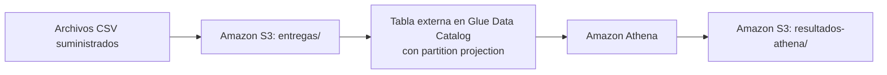

# Entregas de paquetes: S3 + Glue (partition projection) + Athena con Terraform

Los CSV diarios de intentos de entrega se guardan en S3 bajo `entregas/fecha=yyyy-MM-dd/`. Una tabla externa
de Glue Data Catalog con **partition projection** permite que Athena encuentre cada fecha sin crawlers ni
registro de particiones. Los resultados de Athena se escriben en `resultados-athena/` del mismo bucket.



El enunciado original está en [ENUNCIADO.md](ENUNCIADO.md).

## Estructura

| Ruta | Contenido |
| --- | --- |
| `infraestructura/` | Terraform: bucket, prefijos, base de datos y tabla de Glue, workgroup de Athena y outputs |
| `consultas/` | SQL de la demostración inicial y de la verificación del tercer día |
| `scripts/athena.sh` | Ejecuta una consulta en el workgroup, guarda el CSV y registra el ID de ejecución |
| `resultados/inicial/`, `resultados/final/` | Resultados obtenidos en Athena por etapa |
| `evidencias/` | Salidas de `terraform apply`/`destroy`, outputs y registro de ejecuciones de Athena |
| `respuestas.md` | Respuestas a las preguntas conceptuales |

## Prerrequisitos

- Ubuntu (WSL2) o Linux/Mac con `bash`.
- Una cuenta de AWS con permisos sobre S3, Glue y Athena.
- AWS CLI v2, Terraform >= 1.5 y `git`.

```bash
sudo apt update && sudo apt install -y unzip git curl gnupg software-properties-common

# AWS CLI v2
curl -sSL "https://awscli.amazonaws.com/awscli-exe-linux-x86_64.zip" -o awscliv2.zip
unzip -q awscliv2.zip && sudo ./aws/install && rm -rf aws awscliv2.zip

# Terraform (repositorio oficial de HashiCorp)
wget -O- https://apt.releases.hashicorp.com/gpg | sudo gpg --dearmor -o /usr/share/keyrings/hashicorp-archive-keyring.gpg
echo "deb [signed-by=/usr/share/keyrings/hashicorp-archive-keyring.gpg] https://apt.releases.hashicorp.com $(lsb_release -cs) main" \
  | sudo tee /etc/apt/sources.list.d/hashicorp.list
sudo apt update && sudo apt install -y terraform

aws --version && terraform version
```

## Configuración

Región usada: **`us-east-1`** (variable `region`).

```bash
aws configure          # Access key, Secret key, region us-east-1, output json
# Con AWS Academy / credenciales temporales, pegar también el token en ~/.aws/credentials (aws_session_token)
aws sts get-caller-identity
```

Variables de Terraform (todas tienen valor por defecto):

| Variable | Valor por defecto |
| --- | --- |
| `region` | `us-east-1` |
| `nombre_bucket` | vacío: se usa `de-final-entregas-<id de cuenta>` |
| `nombre_base_datos` | `entregas_db` |
| `nombre_tabla` | `entregas` |
| `nombre_workgroup` | `entregas_wg` |
| `fecha_inicio` / `fecha_fin` | `2026-10-01` / `2026-10-03` |

Propiedades de proyección que define la tabla:

```text
projection.enabled             = true
projection.fecha.type          = date
projection.fecha.format        = yyyy-MM-dd
projection.fecha.range         = 2026-10-01,2026-10-03
projection.fecha.interval      = 1
projection.fecha.interval.unit = DAYS
storage.location.template      = s3://<bucket>/entregas/fecha=${fecha}/
skip.header.line.count         = 1
```

## 1. Despliegue

Desde la raíz del repositorio:

```bash
cd infraestructura
terraform init
terraform fmt -check && terraform validate
terraform plan -out tfplan
terraform apply -no-color tfplan 2>&1 | tee ../evidencias/aplicacion_terraform.txt
terraform output -json > ../evidencias/outputs.json
cd ..

BUCKET=$(terraform -chdir=infraestructura output -raw bucket)
echo "$BUCKET"
```

## 2. Demostración inicial (días 1 y 2)

Se cargan **solo** dos archivos, uno por uno (sin `--recursive`):

```bash
aws s3 cp "data/entregas/fecha=2026-10-01/entregas.csv" "s3://$BUCKET/entregas/fecha=2026-10-01/entregas.csv"
aws s3 cp "data/entregas/fecha=2026-10-02/entregas.csv" "s3://$BUCKET/entregas/fecha=2026-10-02/entregas.csv"
aws s3 ls "s3://$BUCKET/entregas/" --recursive
```

Consultas de la etapa `inicial`:

```bash
bash scripts/athena.sh inicial consultas/intentos_por_fecha_estado.sql         resultados/inicial/intentos_por_fecha_estado.csv
bash scripts/athena.sh inicial consultas/porcentaje_exito_por_fecha_ciudad.sql resultados/inicial/porcentaje_exito_por_fecha_ciudad.csv
bash scripts/athena.sh inicial consultas/duracion_promedio_2026-10-02.sql      resultados/inicial/duracion_promedio_2026-10-02.csv

diff resultados/inicial/intentos_por_fecha_estado.csv         resultados_esperados/intentos_por_fecha_estado_inicial.csv
diff resultados/inicial/porcentaje_exito_por_fecha_ciudad.csv resultados_esperados/porcentaje_exito_por_fecha_ciudad_inicial.csv
diff resultados/inicial/duracion_promedio_2026-10-02.csv      resultados_esperados/duracion_promedio_2026-10-02.csv
```

`diff` sin salida significa que el resultado coincide con la referencia. En esta etapa la tabla tiene 12 registros.

## 3. Nueva fecha (día 3): solo subir y consultar

No se modifica Terraform ni la tabla, no se ejecutan crawlers, `MSCK REPAIR TABLE` ni `ALTER TABLE ADD PARTITION`:

```bash
aws s3 cp "data/entregas/fecha=2026-10-03/entregas.csv" "s3://$BUCKET/entregas/fecha=2026-10-03/entregas.csv"

# Verificación: 6 registros del día 3, conteo por estado y total de 18
bash scripts/athena.sh final consultas/verificacion_tercer_dia.sql resultados/final/verificacion_tercer_dia.csv  1
bash scripts/athena.sh final consultas/verificacion_tercer_dia.sql resultados/final/conteo_estado_tercer_dia.csv 2
bash scripts/athena.sh final consultas/verificacion_tercer_dia.sql resultados/final/total_registros.csv         3

# Agregados sobre los tres días
bash scripts/athena.sh final consultas/intentos_por_fecha_estado.sql         resultados/final/intentos_por_fecha_estado.csv
bash scripts/athena.sh final consultas/porcentaje_exito_por_fecha_ciudad.sql resultados/final/porcentaje_exito_por_fecha_ciudad.csv

diff resultados/final/intentos_por_fecha_estado.csv         resultados_esperados/intentos_por_fecha_estado_final.csv
diff resultados/final/porcentaje_exito_por_fecha_ciudad.csv resultados_esperados/porcentaje_exito_por_fecha_ciudad_final.csv
```

Cada ejecución queda registrada en `evidencias/ejecuciones_athena.csv` con `etapa,archivo_sql,id_ejecucion,archivo_resultado`.
`consultas/verificacion_tercer_dia.sql` tiene tres sentencias; el último argumento de `athena.sh` indica cuál ejecutar.

## 4. Limpieza

Primero se guardan y suben las evidencias. Luego:

```bash
aws s3 rm "s3://$BUCKET" --recursive          # vacía datos y resultados de Athena
cd infraestructura
terraform destroy -auto-approve -no-color 2>&1 | tee ../evidencias/eliminacion_terraform.txt
cd ..
aws s3 ls "s3://$BUCKET" 2>&1 | head -1      # debe indicar que el bucket no existe
```

El bucket tiene `force_destroy = true` y el workgroup `force_destroy = true`, así que `terraform destroy`
elimina todos los recursos aunque queden objetos o historial de consultas.
